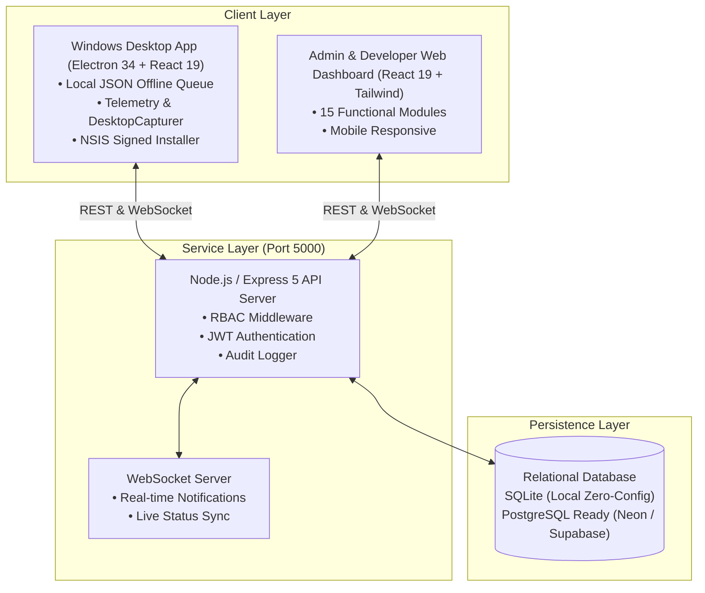

# Frame Production — Complete System Architecture & Operations

Production-ready employee attendance, workstation telemetry, break management, leave application, and monthly performance ranking platform built specifically for **Frame Production**.

---

## 🚀 Quick Access

- **Web Admin Dashboard:** [http://localhost:3000](http://localhost:3000)
- **Central Backend API:** [http://localhost:5000](http://localhost:5000)
- **Health Check Endpoint:** [http://localhost:5000/api/health](http://localhost:5000/api/health)
- **Windows Desktop Installer:** [`client-desktop/release/Frame Production Setup 1.0.0.exe`](client-desktop/release/Frame%20Production%20Setup%201.0.0.exe)
- **Portable Desktop App:** [`client-desktop/release/win-unpacked/Frame Production.exe`](client-desktop/release/win-unpacked/Frame%20Production.exe)

---

## 👥 Seeded Accounts (21 Total)

| Role | Username | Initial Password | Permissions |
| :--- | :--- | :--- | :--- |
| **Developer** | `developer` | `DevPass@2026` | Full system access, DB backups, branding, immutable account protection |
| **Admin (Operations)** | `admin_ops` | `AdminPass@2026` | Break approvals, attendance search, work monitoring, audit logs |
| **Admin (HR)** | `admin_hr` | `AdminPass@2026` | Leave approvals, employee profiles, account resets, performance reports |
| **Admin (Lead Editor)** | `admin_lead` | `AdminPass@2026` | Team assignment, live activity monitoring, temporary exits |
| **Employees (17)** | `emp_01` to `emp_17` | `EmpPass@2026` | Clock In/Out, break requests, leave forms, self performance scorecard |

---

## 🛠️ System Architecture



---

## ⚙️ Running & Building

### 1. Launch Services
Double-click `start_servers.bat` or run:
```powershell
# Server
cd server
npm start

# Web Dashboard
cd client-web
npm run preview -- --port 3000 --host
```

### 2. Build Windows Desktop App
```powershell
cd client-desktop
npm run build:electron
npm run dist
```
The output will be placed in `client-desktop/release/`.

### 3. Verification & Automated Tests
```powershell
python test_end_to_end.py
```
Runs 13 end-to-end integration test suites verifying authentication, offline sync, leave requests, performance ranking formulas, and RBAC guardrails.
